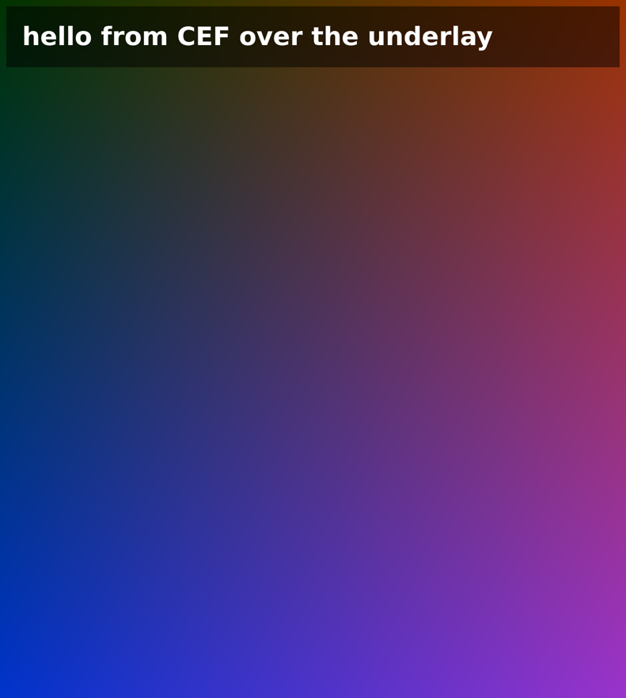

# Phase 0: risk checks

Results of the checks the plan puts first (§7). Machine: Ryzen AI 9 HX 475, Radeon 890M (Mesa 26.1.8, radeonsi), Gentoo, Xorg + dwm. All numbers below are from runs on it.

## 1. CEF off-screen rendering into GPU buffers on X11: works

**Setup.** CEF 154.0.34 (Chromium 154.0.8037.98), the official "minimal" Linux build, checked against its published SHA1. The test program is [`appshell/spike/osr_spike.c`](../appshell/spike/osr_spike.c): an X11 window with an EGL/GLES 3.2 context, a CEF browser with `windowless_rendering_enabled` and `shared_texture_enabled`, and `OnAcceleratedPaint` buffers imported with `EGL_EXT_image_dma_buf_import` and blended over a colored "underlay" standing in for the video.

**Libraries, 0 new packages.** `libcef.so` needs six libraries the system doesn't have:
- NSS, NSPR and libxkbcommon: copies of the ones Thorium already bundles (nspr 4.39, nss 3.125, libxkbcommon 1.13.2).
- `libcups.so.2`: replaced by [`appshell/cups-stub`](../appshell/cups-stub/cups_stub.c), 68 do-nothing functions. CEF never prints. `check-symbols.sh` compares the stub against what `libcef.so` imports, and it caught two functions missed on the first try.

`libcef.so` has `RUNPATH $ORIGIN`, so CEF, the bundled libraries and the stub sit in one runtime folder (hard links, no extra disk).

**Results:**

| | |
|---|---|
| CEF initialized | 117–161 ms after start |
| First frame of a local page | 204–219 ms after start |
| First frame of Seanime's Discover page (served locally) | 307 ms after start |
| Buffer CEF hands over | 1 plane, BGRA, implicit modifier (`DRM_FORMAT_MOD_INVALID`), stride 6400 for a 1582 px wide window |
| Per frame, vsync off, Discover with its carousel running (360 frames) | import 0.04 ms, draw + `glFinish` 0.46 ms, swap 0.04 ms: **0.73 ms in all** |
| Memory with Discover loaded (PSS) | main process 130 MB, renderer 208 MB, GPU 77 MB, network 41 MB, storage 28 MB: **485 MB** |

**Found along the way:**
- CEF treats positional command-line arguments as start URLs. The real program takes no positional arguments in the browser process.
- Chromium reuses the memory that held the environment strings for the process title, so a pointer from `getenv` taken before `cef_initialize` reads as an empty string afterwards. The first runs loaded nothing because the URL was empty. Anything read from the environment is copied before CEF starts.
- With the display powered off (DPMS off, which it was during these runs), Xorg paces a window's buffer swaps with a 1 Hz fallback timer, so a swap with vsync blocks for about a second. The real program must not draw or swap while the window or display isn't visible. It tells CEF the view is hidden instead, which also lets Chromium stop rendering. Frame pacing with the screen on is still to be measured.

**Still open from this check:**
- **Memory** is above the plan's ~300 MB target. Candidates: running the network service in-process, merging the storage service, a smaller image cache, and V8 heap limits. Each is to be measured in phase 3.
- **Pacing at 120 Hz with the screen on**, and VRR.

## 2. libmpv render API in the same context, Anime4K A+A: not yet run

## 3. Microsoft app registration for mclaunch: needs the owner

Registering the Azure app and asking Mojang for Minecraft API access needs the owner's Microsoft account.
