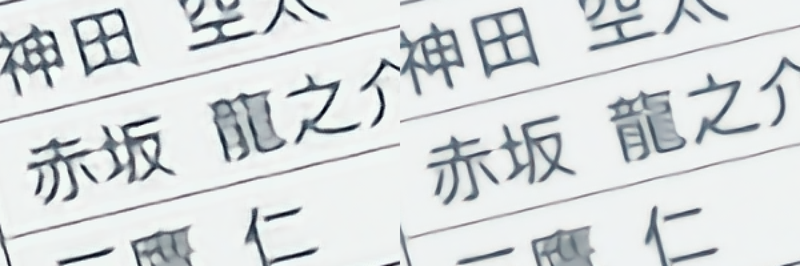

# Shader guide

Which shader preset to use for which video, measured on the target laptop (Radeon 890M, 2880x1800 panel at 119.88 Hz; a 16:9 video fills 2880x1620). The presets are in the player's menu: up arrow > Shaders > **Recommended**. Movies & TV is live action and never uses shaders.

## Quick pick

| Your video | Pick | What runs | GPU per frame |
|---|---|---|---|
| 1080p Blu-ray or web release (most anime) | **Auto** | Crisp: Anime4K A+A Fast + CfL | 20 ms |
| 720p web release, older TV anime | **Auto** | Anime4K A+A HQ + CfL | 23 ms |
| DVD or other SD (480p, 576p) | **Auto** | Anime4K C+A HQ + CfL | 18 ms |
| Noisy, blocky or low-bitrate rip | **Clean & Crisp** | Anime4K C+A Fast + CfL | 26 ms |
| 4K Blu-ray remux, 1440p, anything HDR | **Auto** (or Off) | nothing | 2.5 ms |
| Any of the above on battery | **Crisp Light** | Anime4K A Fast + CfL | 13 ms |

A 24 fps frame lasts 41.7 ms; GPU times are for 1080p sources unless the row says otherwise. Auto decides by the size of the video and whether it is HDR. It can't see how clean a file is, so a rough rip needs Clean & Crisp chosen by hand. Press **Z** for Stats for Nerds: the Shaders line names the preset and what Auto picked, and Avg Render Time shows the GPU time per frame with each shader's share.

## The presets

Every preset starts with chroma-from-luma (CfL), which rebuilds the half-resolution colour of the video from the full-resolution brightness: red and orange edges come out about 4% sharper for 0.6 ms.

| Preset | Chain | Look | GPU / frame | Package power |
|---|---|---|---|---|
| Off | `ewa_lanczossharp` scaling | faithful, soft lines | 2.5 ms | 23 W |
| Crisp Light | CfL + Anime4K A (Fast) | dark lines, a little softer than Crisp | 12.9 ms | 36–39 W |
| Crisp | CfL + Anime4K A+A (Fast) | sharp, dark, defined lines | 19.5 ms | 45–47 W |
| Clean & Crisp | CfL + Anime4K C+A (Fast) | denoised first, then sharpened | 25.7 ms | 52 W |
| Auto | one of the above or an HQ chain, by video | | | |

Measured in the real player, plugged in on the gaming power plan (GPU at full clock), 1080p stream, the mouse moving over the controls. Power is the whole chip (amdgpu's PPT sensor).

The crisp look comes from one step: Anime4K's **Restore** network, run at the video's own resolution. It is trained to undo the blur of anime that was upscaled to 1080p, which makes lines darker and thinner. Measured with ffmpeg's `blurdetect` on three frames of a 1080p Blu-ray (lower is sharper):

| | Blur score |
|---|---|
| Off | 7.27 |
| Crisp (A+A Fast + CfL) | **6.48** |
| A+A HQ | 6.49 |
| Crisp Light (A Fast + CfL) | 6.71 |
| ArtCNN, CuNNy, Anime4K-Ultra (all variants) | 7.08–7.29 |

Crisp Light keeps about 70% of Crisp's sharpening for two thirds of its GPU time. A+A HQ is no sharper than Fast, only slightly smoother along curves, and at 1080p it takes 50 ms per frame, so it drops frames here (129 in 20 s).

## Source by source

**1080p Blu-ray or web.** Crisp. Most 1080p anime is drawn at a lower resolution and upscaled, which is the blur Restore removes. Auto picks Crisp for anything between about 1 and 2.2 million pixels, which includes 1920x800 films and 1440x1080 4:3 releases.

**720p.** Auto runs A+A **HQ** here, which a 1080p source can't afford: 720p has less than half the pixels, so HQ takes 23 ms. Its bigger networks draw cleaner strokes than Fast on small detail. Crisp also works if you prefer the lighter load.

**DVD and other SD.** Auto runs C+A HQ: Mode C upscales with a denoising network first, then A restores the lines. A+A on its own is too aggressive at this size. It merges dense detail into blobs: in the test below the kanji 龍 turns into a smear and small eyelash marks disappear, even with A+A HQ.

**Rough rips** (low bitrate, blocking, noise, heavy grain from re-encoding). Clean & Crisp. A+A sharpens whatever is in the frame, compression artifacts included; C+A denoises before it sharpens. Turn **Debanding** on for these (a separate switch in the same menu): it smooths the stair-steps that low bitrates leave in gradients and skies.

**4K Blu-ray remux, 1440p, HDR.** No shaders; Auto switches them off by itself. The screen shows the video at 2880x1620, less than a 4K source has, so nothing is upscaled and Anime4K's upscalers don't run at all. Restore would still run, on four times the pixels of 1080p, for an effect that the downscale to the screen mostly averages away. Anime4K is also trained on SDR pictures and would distort HDR. A remux has no banding to fix, so Debanding can be off too. The picture comes from mpv's scaling and HDR handling: with `colormode watch` running, the screen switches to HDR while the video is fullscreen.

**On battery.** Crisp Light, or Off if battery matters more than the look. Shaders are the biggest power cost in playback: Crisp doubles the chip's power draw against Off (45 against 23 W on the gaming plan). On the battery plan the GPU runs at lower clocks, so every preset takes longer per frame than in the tables above; those numbers weren't measured.

## Not offered, and why

| Shader | GPU / frame at 1080p | Why not |
|---|---|---|
| Anime4K A+A HQ | 49.5 ms | Too slow for 1080p; Auto uses it for 720p |
| Anime4K A HQ + CfL | 34 ms | Fits, but GPU 58–96% busy for no sharper lines than Crisp |
| Anime4K B / B+B | 19.5 ms (B+B) | Softer than A+A at the same cost; meant for 720p releases that ring and alias |
| ArtCNN C4F16 DS / C4F32 DS (v1.6.2) | 16.2 / 40.5 ms | Faithful to the source: barely sharper than Off |
| ArtCNN R4F32 YCbCr DS (2026) | 120 ms | Far too slow |
| CuNNy 4x32 / 8x32 DS (int8 builds) | 27.4 / 41.9 ms | No sharper than Off |
| Anime4K-Ultra DbL | 16.9 ms | No sharper than Off |

The ArtCNN, CuNNy and Anime4K-Ultra times are from standalone mpv with the player's settings; inside the player each takes about 1.6 ms more (A+A Fast: 17.3 against 19.0 ms). ArtCNN is still in the menu (ArtCNN Preset) for anyone who wants the most faithful picture: it scored highest against the source in the README's picture quality test. The Anime4K and Custom modes are unchanged.

## Frame timing

The player now times frames by the audio clock (`video-sync=audio`) instead of `display-resample`. The panel actually refreshes at 119.88 Hz, exactly 5 refreshes per frame of 23.976 fps video (and 4 per frame of 29.97 fps TV), so every frame stays on screen for the same time without resampling. `display-resample` drew each frame again on every refresh. Once a shader frame took longer than one refresh (8.3 ms), it skipped refreshes and held some frames for 4 or 6 instead of 5: the dropped and delayed frames seen in Stats.

| Crisp, 20 s in the real player | display-resample (before) | audio (now) |
|---|---|---|
| Frames held exactly 5 refreshes | 475 of 480, 4 or 6 for the rest | 478 of 478 |
| Delayed frames | 12–91 | 0 |
| GPU busy | 79–80% | 62–64% |
| Package power | 52–53 W | 45–47 W |
| Package power with shaders Off | 33 W | 23–24 W |

## How this was measured

- **Content:** Sakurasou no Pet na Kanojo episode 20 ([smol] BD 1080p HEVC 10-bit), 75 s; Frieren episode 1 (SubsPlease 1080p web) streamed from Real-Debrid for the in-player runs.
- **GPU time:** mpv's own per-pass timing (`vo-passes`), sum of the passes for a new frame.
- **Smoothness:** mpv's `--dump-stats` timestamps of every swap, turned into refreshes per video frame (`appshell/test/bench-playback.mjs` with `STATS=`), plus mpv's drop counters.
- **Sharpness:** ffmpeg `blurdetect` on full-screen screenshots at three timestamps, plus side-by-side crops at 2x.
- **720p and SD:** simulated by having mpv scale the 1080p frames down (Lanczos) before the shaders, like a clean 720p or 480p master. Real DVDs and web 720p releases have their own noise and blur, which Mode C handles better than A.
- **Auto:** checked in the real player on the 1080p stream, then with mpv filters scaling it to 720p and 480p and marking it PQ (HDR): it loaded A+A Fast, A+A HQ, C+A HQ and nothing, in that order, and the Stats overlay named each one.
- Shader versions: Anime4K v4.0.1, ArtCNN v1.6.2 and its 2026 YCbCr experiments, CuNNy (August 2025), Anime4K-Ultra (April 2026).
